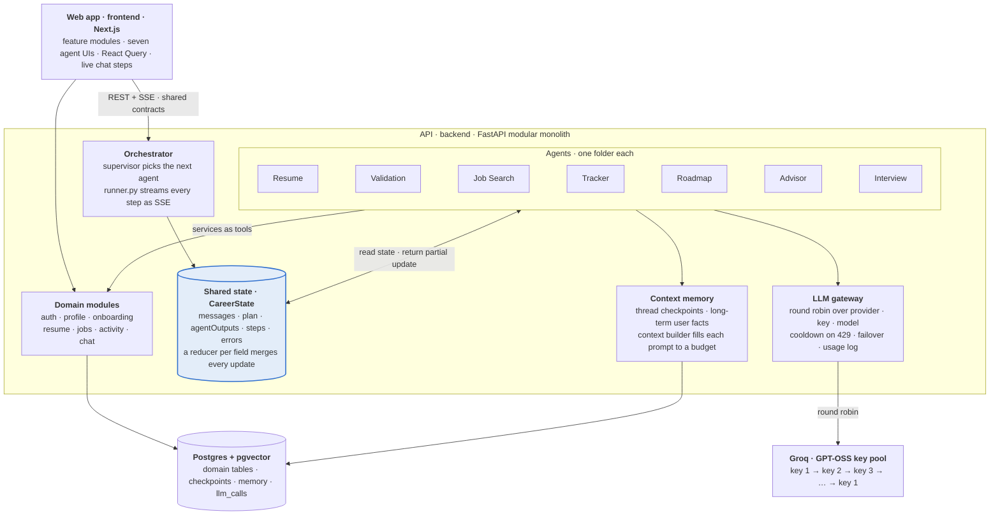
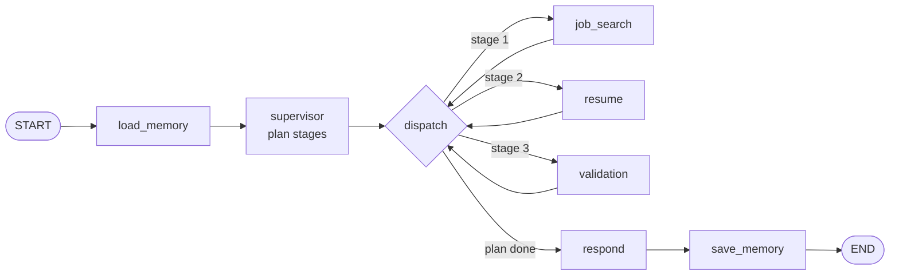

# Career Compass — Architecture & Implementation Plan

_As of 2026-10-05_

Career Compass is one repository holding two modular monoliths: the Next.js web app (TypeScript) and a FastAPI backend (Python). The seven agents live in their own folders, talk only through one LangGraph state merged by reducer functions, and reach the LLMs through a gateway that rotates round robin across your API keys.

---

## 1. At a glance



A chat message enters the orchestrator. The orchestrator runs agents one after another, or in parallel, and each agent reads the shared state and writes back only its own slice. Every model call passes through the context builder and the round-robin gateway.

---

## 2. Repository layout

One repo with two separate apps: `frontend/` (Next.js) and `backend/` (FastAPI). Each side keeps every endpoint it owns in one file: `frontend/src/lib/endpoints.ts` (pages + every API call) and `backend/app/endpoints.py` (every served route, checked against the running app by a test). The backend serialises to the camelCase JSON the frontend expects and publishes OpenAPI at `/api/docs`.

```text
career-compass/
├── frontend/                     # Next.js 16 — frontend modular monolith
│   └── src/lib/endpoints.ts      # every page route + every backend call
├── backend/                      # FastAPI + LangGraph (Python) — backend modular monolith
│   └── app/endpoints.py          # every route the API serves (test-checked)
├── docker-compose.yml            # Postgres 16 + pgvector for local dev
└── package.json                  # root scripts: dev / build / test / lint
```

- **Why one repo:** one PR can change the contract, the API and the UI together.
- **Why still "monolith":** each app deploys as a single unit. Modules are separated by folders and lint rules, not by network calls.

---

## 3. Frontend modular monolith (`frontend`)

The web app is split into feature modules that mirror the backend modules. `src/app/` keeps only routing and metadata, and each page renders one module's view.

```text
frontend/src/
├── app/                          # routes only: page.tsx + metadata, no logic
├── modules/
│   ├── auth/                     # sign-in / sign-up
│   ├── profile/                  # profile hub, setup wizard
│   ├── resume/                   # upload, tailored resumes, export
│   ├── jobs/
│   ├── activity/
│   ├── chat/                     # orchestrator chat + live step stream (SSE)
│   └── agents/
│       ├── resume/  validation/  job-search/  productivity/
│       └── roadmap/  advisor/  interview/      # one folder per agent UI
└── shared/
    ├── ui/                       # shadcn primitives, LineButton, OutlineIcon
    ├── layout/                   # AppShell, AnimatedLines, Chatbot button
    └── lib/                      # apiClient (wraps contracts), utils
```

Each module has the same inside: `components/`, `hooks/` (React Query calls built on the contracts endpoints), `types.ts`, and an `index.ts` that is its only public entry.

**Boundary rules (enforced by the ESLint `boundaries` plugin):**

1. A module imports another module only through its `index.ts`.
2. `shared/` never imports from `modules/`.
3. Server data lives in React Query, not Context. Context holds only UI state (chat panel open, active conversation).
4. The 677-line `AgentBody.tsx` is split into the seven agent folders, one file per agent screen.

---

## 4. Backend modular monolith (`backend`)

The API is one FastAPI process (Python 3.11), built in five layers: business modules, agents, the orchestrator that wires agents into a graph, shared memory, and core infrastructure (config, security, database, LLM gateway).

```text
backend/app/
├── main.py                       # composition root: create_app() wires everything
├── core/                         # config (.env), security, errors, envelope, logging, middleware
├── db/                           # SQLAlchemy 2 async engine, sessions, Alembic runner
├── modules/                      # business modules, all layered the same way
│   ├── auth/  profile/  chat/  health/
│   │   └── (each) router.py · dependencies.py · service.py · repository.py · models.py · schemas.py · __init__.py
├── agents/                       # ONE FOLDER PER AGENT
│   ├── base.py                   # AgentSpec / AgentContext / AgentResult contract
│   ├── registry.py               # lists all agents for the orchestrator
│   └── job_search/ resume/ validation/ productivity/ roadmap/ advisor/ interview/
├── orchestrator/
│   ├── state.py                  # the shared graph state + reducers
│   ├── planner.py                # supervisor: picks agents, orders them into stages
│   ├── graph.py                  # builds the StateGraph from the registry
│   └── runner.py                 # graph stream → SSE events for /api/chat/orchestrate
├── memory/                       # long-term store + context builder
└── llm/                          # round-robin gateway (section 7)
```

**Module layers.** Each of the layers below has its own file:

| File | Layer | Holds |
| --- | --- | --- |
| `router.py` | HTTP | FastAPI routes; parses requests, sets cookies, returns the envelope |
| `dependencies.py` | Wiring | Builds the service per request; `CurrentUserId` protects any route |
| `service.py` | Business | The rules; no FastAPI, no SQLAlchemy |
| `repository.py` | Data | All SQL for the module |
| `models.py` / `schemas.py` | Shapes | SQLAlchemy tables / Pydantic request-response models |
| `__init__.py` | Public interface | The only import path other modules may use |

**Agent folder contract.** Every agent folder has the same four files, so adding an eighth agent means copying a folder and adding one line to `registry.py`:

| File | Holds |
| --- | --- |
| `agent.py` | `run(ctx: AgentContext) -> AgentResult` plus `SPEC` (id, description, `reads`, keywords). Includes a `_fallback` that works with no LLM. |
| `prompt.py` | The system prompt. |
| `schema.py` | Pydantic model for the agent's structured output (e.g. `ValidationOutput`). |
| `__init__.py` | Exports `SPEC`. |

**Boundary rules.** `uv run lint-imports` fails the build if any of these break:

1. Inside a module, imports only point downward: router → dependencies → service → repository → models.
2. `service.py` never imports FastAPI or SQLAlchemy.
3. `core/` and `db/` never import modules, agents, the orchestrator, memory or the LLM gateway.
4. Agents never import each other. They share data only through graph state (next section).
5. Agents never import the database, SQLAlchemy, FastAPI or any module.

---

## 5. Agent communication: LangGraph state and reducers

Agents never call each other. Each agent is a node in one LangGraph `StateGraph`: it reads the shared state and returns a partial update. A reducer per field decides how that update merges in. Reducers are also what make it safe to run two agents in parallel and merge both results.

```python
# backend/app/orchestrator/state.py
class CareerState(TypedDict, total=False):
    user_id: str; run_id: str; request: str          # input (last write wins)
    profile: dict[str, Any]; history: list[dict[str, str]]
    memories: list[str]                              # recalled long-term facts
    plan: list[list[str]]                            # stages; agents in a stage run in parallel
    answer: str
    agent_outputs: Annotated[dict[str, Any], merge_dicts]      # each agent owns one key
    steps:         Annotated[list[Step], operator.add]         # append-only → UI stepper
    memory_writes: Annotated[list[MemoryWrite], operator.add]  # facts to save after the run
    errors:        Annotated[list[AgentFailure], operator.add]
```

### How a request flows

Example: _"tailor my resume for a role and validate it"_



1. **load_memory** recalls the user's long-term facts.
2. **supervisor** plans the stages: `[["job_search"], ["resume"], ["validation"]]`. Agents are ordered by the outputs they declare they read. With LLM keys configured, the LLM chooses which agents run; without keys, keyword rules do.
3. **job_search** writes `agent_outputs["job_search"]`.
4. **resume** reads it and writes `agent_outputs["resume"]`, a draft tailored to the top match.
5. **validation** reads the resume and writes `agent_outputs["validation"]`, the ATS checks.
6. **respond** composes the answer, and **save_memory** stores the facts the agents proposed.

Agents in one stage run in parallel; a "full review" runs `job_search` and `productivity` together, for example. Every agent returns to a single `dispatch` join node, which routes once per stage. A per-agent router only sees its own node's write, so it would re-run parallel siblings; routing at the join sees the whole stage's merged state.

`runner.py` turns the graph stream into Server-Sent Events: `plan`, `step` (running, completed or failed), `answer`, `memory` and `done`. The step events use the `{ agentId, status, … }` shape the dashboard's orchestration UI already renders.

---

## 6. Context memory

Memory has three tiers. A context builder assembles what each agent sees within a fixed budget, so a long history never overflows the model's window.

| Tier | Stored in | Lives for | Holds |
| --- | --- | --- | --- |
| Working | Graph state (`CareerState`) | One run | Request, plan, agent outputs for this run |
| Conversation | LangGraph checkpointer keyed by conversation id + `chat_messages` table | The conversation | Agent outputs carry across turns; recent messages survive restarts |
| Long-term | `agent_memories` table, per user, deduplicated | The user | Facts ("Exploring roles: Data Engineer", "Has a resume draft for …") recalled in any conversation |

**Context builder** (`app/memory/context.py`) runs before every agent and fills the prompt in this order until `MEMORY_CONTEXT_BUDGET_CHARS` runs out:

1. The user's request.
2. The profile snapshot (skills, goals, preferences).
3. Outputs of the agents this agent declares it `reads`.
4. Long-term memories recalled for this request.
5. Recent messages, newest first.

**Phase 3 upgrades.** Both happen behind the existing interfaces, so no agent changes:
- the in-process checkpointer becomes `AsyncPostgresSaver`, which survives restarts;
- keyword-overlap recall becomes pgvector similarity search.

---

## 7. LLM gateway: round robin with failover

All LLM calls go through one `LlmGateway` in `app/llm/`. It rotates across a pool of (key, model, tier) entries and skips any entry that is rate-limited or failing, so one exhausted key never stops an agent. The pool is Groq API keys running OpenAI's open-weight GPT-OSS models: `openai/gpt-oss-120b` for the `large` tier and `openai/gpt-oss-20b` for `fast`. The gateway speaks the OpenAI chat format through `httpx`, so any OpenAI-compatible provider can be added.

```python
# backend/.env — comma-separated; SecretStr in code; never logged
GROQ_API_KEYS=gsk_a,gsk_b,gsk_c

# Agents call it through a helper that falls back offline if every key fails:
output, used_llm = await generate(ctx, system=SYSTEM_PROMPT, schema=ValidationOutput,
                                  fallback=lambda: _fallback(ctx), tier="fast")
```

| Event | Gateway action |
| --- | --- |
| Normal call | Next entry in the tier, round robin; skip entries in cooldown |
| 429 rate limit | Cool that entry for the `Retry-After` time (else 2 s doubling, max 60 s); retry on the next entry at once |
| 5xx or timeout | Retry on the next entry; 3 failures in a row open the circuit for 30 s |
| 401 / 403 | Disable that key until restart and log an alert (key id only); retry on the next entry |
| Other 4xx | No retry: the request itself is wrong |
| Every entry tried | `LlmUnavailable`; the agent returns its offline fallback and the run still completes |
| Invalid JSON | Validated against the agent's Pydantic schema; one retry on the next key |

- **Usage log:** every call logs entry id, model, latency and token counts. API keys never appear in logs, `repr()` or `/api/health`.
- **Scaling:** the rotation pointer and cooldowns live in process memory, which is correct for one API instance. Running several instances would move them to Redis.

---

## 8. Implementation plan

Eight phases, built in order. Each phase ends in a working app and a check that proves it, so you can stop and review between any two. Phase 6 (frontend modules) can run alongside phases 4–5 once phase 1 is done.

| # | Phase | Delivers | Done when |
| --- | --- | --- | --- |
| 0 | Repo restructure ✅ | Next.js app in `frontend/`; Python backend in `backend/`; one endpoints file per side; Postgres + pgvector in `docker-compose.yml` | `npm run build` builds everything and the web app looks and behaves exactly as today |
| 1 | API foundation ✅ (boilerplate) | FastAPI, validated `.env` config, response envelope, error handlers, SQLAlchemy models + Alembic migrations, JWT auth, profile + chat modules | Integration tests pass; sign-in and profile edits persist in Postgres instead of `localStorage` |
| 2 | LLM gateway | Pool loading, round robin, cooldowns, circuit breaker, usage log | Fake-provider tests for 429 / 500 / 401 fail over correctly; live smoke test shows entries rotating |
| 3 | Context memory | Checkpointer, long-term store, context builder, summariser, memory extractor | A conversation resumes after an API restart; tests confirm prompts stay inside the token budget |
| 4 | Orchestrator + first agent | State + reducers, supervisor, graph, SSE stream, Validation agent; dashboard chat wired to `/api/chat/orchestrate` | Typing "validate my resume" streams real agent steps and a real result |
| 5 | Remaining six agents | Resume (with upload + parsing), Job Search (needs a job data source), Productivity, Roadmap, Advisor, Interview — one at a time | Per agent: its tests pass and its page runs on the real API |
| 6 | Frontend modules | `modules/` structure, `AgentBody.tsx` split into seven agent folders, React Query hooks, boundary lint rules | Boundary lint passes; no server data left in `localStorage` |
| 7 | Hardening + deploy | Per-user rate limits, prompt-injection guard on resume text, tracing, Playwright e2e tests, CI, deployment | e2e suite passes in CI against a deployed preview |

---

## 9. Decisions to confirm before work starts

The plan above uses the recommended option for each. Changing one changes only the phase named.

| Decision | Recommended | Alternative | Affects |
| --- | --- | --- | --- |
| Which LLM providers? | Groq keys running GPT-OSS models | xAI Grok + OpenAI keys (same gateway, different pool entries) | Phase 2 config only |
| Backend language | **Decided: Python (FastAPI + LangGraph)** | — | Phases 1–5 |
| Job data source | A jobs API such as JSearch or Adzuna (needs a key) | Keep mock jobs for now | Phase 5, Job Search agent |
| Database hosting | Local Docker for dev; Neon or Supabase Postgres for deploy | Any Postgres 16 with pgvector | Phases 1, 7 |
| Lovable | Keep `main` on the old app; develop on `nextjs-migration` | Retire the Lovable project | Phase 0 |

- [ ] Confirm or change the five decisions above
- [ ] Say **"proceed"** to start Phase 0
